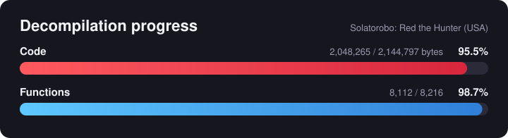
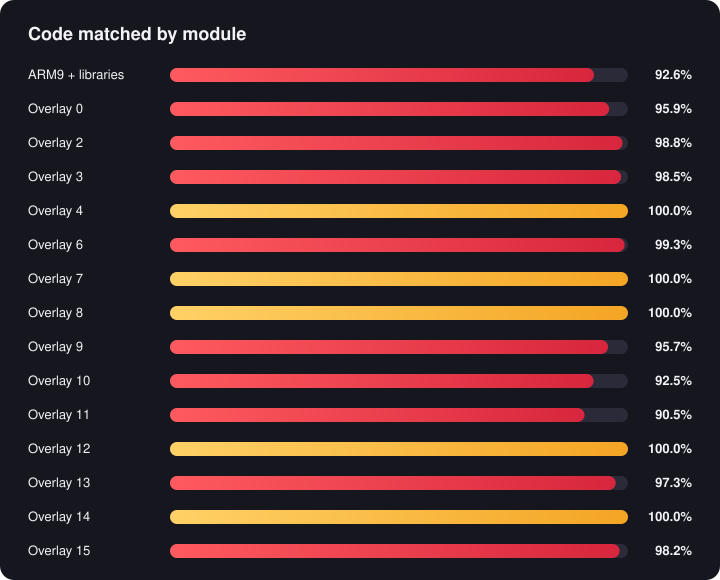

# Solatorobo: Red the Hunter decompilation

*A matching decompilation of CyberConnect2's 2010 airship adventure for the Nintendo DS*

<!-- progress:start -->
**87.5%** of the code and **7,944 / 8,201** functions match the original game (updated 2026-10-25). Fully matched: Overlay 7.
<!-- progress:end -->

## What is this?

This project rebuilds *Solatorobo: Red the Hunter* (Nintendo DS, DSi-enhanced, USA) from C and C++ source that compiles to the exact same machine code as the original game. Every matched function is checked byte for byte against the retail cartridge.

This repository contains no game code or assets. To build it, you need your own legally dumped copy of the game.

<b>Progress by module</b>

 

Most of the TwlSDK and NitroSystem library code (FS, CARD, WM, OS, FX, MI, GX, SND, MATH, Fnd, Gfd, G2d, G3d) is matched under its real names. Run `ninja report` for live numbers in [objdiff](https://github.com/encounter/objdiff), and `python tools/progress.py` to redraw the bars above.

## About the game's code

- Built with Nintendo's TwlSDK (DSi SDK), NitroSystem (NNS) and Actimagine's Mobiclip SDK 1.2.1.
- DSi-enhanced, so it has a few layout quirks that upstream [dsd](https://github.com/AetiasHax/ds-decomp) doesn't handle yet. We build dsd from source with small patches in [`tools/dsd-patches`](tools/dsd-patches):
  1. No ARM9 footer: fall back to the header's build info offset.
  2. TwlSDK autoload entries are 16 bytes, and DTCM sits at `0x02fe0000`.
  3. The `.ctor` runner isn't the last call in the entrypoint.
  4. The exception table is empty.
  5. Gap files share a name, which the linker script check wrongly flagged as duplicates.
- dsd can't rebuild a DSi-enhanced ROM yet (animated banner, arm9i/arm7i), so for now we verify matching code per module with `ninja check` instead of a full ROM SHA1.

## Compiler

The game was built with CodeWarrior for DSi, somewhere between `dsi/1.2` and `dsi/1.3` (mwccarm 4.0 builds 1026 to 1034). Some functions have odd-sized stack frames that newer versions don't produce, `dsi/1.1` breaks other functions, and a few fold a `u16` truncation into the next instruction's operand, which `dsi/1.3p1` no longer does. We use `dsi/1.3` (`mwcc_40_1034` on decomp.me). The prebuilt NitroSystem files that need `dsi/1.1` are listed in `tools/mwcc_versions.py`. The 2.0 compilers that most DS decomps use don't match.

## Building

1. Install Python 3.11+, Ninja, git and a Rust toolchain. On Linux you also need GCC for Wibo.
2. `python -m pip install -r tools/requirements.txt`
3. Put your ROM in [`extract/`](extract/README.md).
4. Put the Metrowerks compilers in `tools/mwccarm/`.
5. `python tools/configure.py usa`, then `ninja`.

The first `ninja` run builds the patched dsd, which takes a few minutes.

## Contributing

[`docs/MATCHING.md`](docs/MATCHING.md) collects every compiler quirk and matching trick we've found so far, from register colouring to string pools. Start there before tackling a function.

## Credits

The build scripts are adapted from the [Phantom Hourglass decompilation](https://github.com/zeldaret/ph) (CC0).
